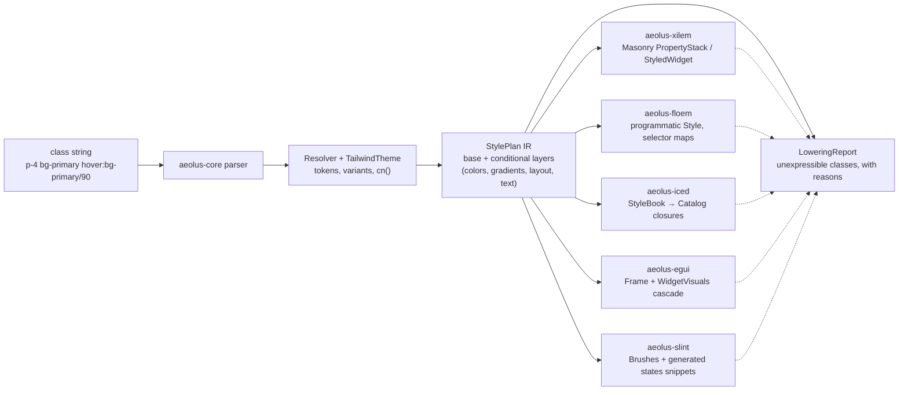

<div align="center">
  
  <p>
    <strong>Tailwind CSS v4 class styling, compiled to native properties for Xilem, Floem, Iced, egui, Slint and GPUI</strong><br/>
    Aeolus parses Tailwind v4 class strings, resolves theme tokens and variants, and lowers
    the result into <code>StylePlan</code>, a typed IR that framework backends turn into
    Masonry property stacks, Floem styles, Iced style books, egui Frames or Slint brushes
    and <code>states</code> snippets. shadcn/ui's v4 class tables ship verbatim, so
    components keep their web vocabulary. Semantics are verified against the
    <code>tailwindcss</code> v4.1.17 source, and every class a backend cannot express is
    reported through <code>LoweringReport</code> — never dropped silently.
  </p>
  <p>
    <a href="https://github.com/elcoosp/aeolus/actions/workflows/ci.yml"></a>
    <a href="CHANGELOG.md"></a>
    <a href="LICENSE-MIT"></a>
    <a href=".github/workflows/ci.yml"></a>
    <a href=".github/workflows/ci.yml"></a>
  </p>
</div>

<p align="center">
  <a href="#quickstart">Quickstart</a> • <a href="#features">Features</a> • <a href="#how-it-works">How it works</a> • <a href="#usage">Usage</a> • <a href="#status">Status</a> • <a href="#learn-more">Learn more</a>
</p>

## Quickstart

Rust 1.96 or newer for the GUI path; `aeolus-core` alone builds on 1.88. Add the crates from git (backends are git-only for now — see [Status](#status)):

```toml
[dependencies]
aeolus-core = { git = "https://github.com/elcoosp/aeolus" }
aeolus-xilem = { git = "https://github.com/elcoosp/aeolus" }
```

Then style any Xilem view with a class string:

```rust
use aeolus_core::{Resolver, shadcn_default};
use aeolus_xilem::TwViewExt;
use xilem_masonry::view::label;

// Once at startup: the embedded shadcn light palette becomes the theme.
let theme = shadcn_default().unwrap();
let resolver = Resolver::new(&theme);

// In a view function: classes in, a styled widget out.
let save = label("Save changes").tw(
    &resolver,
    "p-4 bg-primary text-primary-foreground rounded-md hover:bg-primary/90",
);
```

No build step, no CSS file, no browser. The string is parsed, theme-resolved, and lowered into Masonry properties at runtime; `.tw` panics on unparseable classes in debug builds and warns plus drops styling in release — the honest-failure contract, not a silent no-op.

The same resolver drives the Iced, egui and Slint backends — `aeolus-iced` lowers into a `StyleBook` your Catalog closures resolve per `button::Status`/`&Theme`, `aeolus-egui` lowers into an `egui::Frame` plus the `WidgetVisuals` cascade that plain `egui::widgets::Button` picks up per frame, and `aeolus-slint` lowers into Slint's own value types plus the generated `.slint` property bindings and `states [ … ]` blocks its `TouchArea` machinery restyles from:

```rust,ignore
// egui: a real interactive shadcn button (hover/press restyle via the
// widget-visual cascade — egui's own state machinery).
aeolus_shadcn::egui::button(ui, &resolver, "Save changes",
    ButtonVariant::Default, ButtonSize::Default, "");

// iced: a style book for container(...).style(...) / button(...).style(...).
let book = aeolus_shadcn::iced::button_book(&resolver,
    ButtonVariant::Default, ButtonSize::Default, "");
button(Text::new("Save changes")).style(book.button_style_fn())

// slint: the generated code a TouchArea-driven Rectangle restyles itself
// from — hover/press/disabled/focus are `states` on the element's own
// properties, and every emitted binding is compiler-validated in CI.
let book = aeolus_shadcn::slint::button_book(&resolver,
    ButtonVariant::Default, ButtonSize::Default, "");
println!("{}", book.base_snippet());
println!("{}", book.to_states_snippet_focused("ta", "fs"));
```

## Features

- **Tailwind v4 semantics, checked at the source.** The parser, theme registry, and variant resolver are verified against the `tailwindcss` v4.1.17 source (`candidate.ts`, `compile.ts`, `variants.ts`), not the docs alone. Arbitrary selector variants (`[&:hover]`, `[a&]`, `[@media(print)]`) classify into typed probe conditions or fail with a per-form precise reason.
- **A typed IR, not CSS text.** `StylePlan` carries base plus conditional layers with typed slots (color, padding, borders, shadows, typography, transitions, gradients). Backends consume it directly; `diff()` with cosmetic/geometric lanes drives repaint-only restyling.
- **Gradient backgrounds, native on Masonry.** `bg-linear-*` / `bg-radial` / `bg-conic*` / `bg-none` compose at plan time into `ResolvedStyle.background_gradient` (a separate slot from the solid `background`, mirroring CSS's `background-color` + `background-image` coexistence). Masonry lowers them into its layout-invariant `Background::Gradient` with oklab interpolation; Floem reports with a sharpened geometry reason. Semantics pinned against the real tailwindcss 4.1.17 output (`tools/capture_gradients.mjs`).
- **shadcn/ui class tables, verbatim.** Eight components (Button, Input, Label, Card, Badge, Separator, Skeleton, Alert) copied from the shadcn `new-york-v4` registry; `button()` and `input()` are real interactive widgets on Xilem, the rest are style-only and say so.
- **`cn()` conflict resolution.** tw_merge-compatible: an audited conflict-group table drives classification (including the v0.6 split of `bg-color`/`bg-image` and per-edge gradient stops), approximate equality handles float ties, and the function is total and idempotent on any input — the user's class, merged last, wins.
- **Themes from CSS variables.** `@theme` / `:root` / `.dark` CSS with `calc()` at real operator precedence; the verbatim Tailwind v4 default theme and palette plus shadcn light/dark palettes are embedded via `include_str!`; theme swaps are explicit and version-tracked.
- **A verification emitter + parity harness.** `Resolver::to_css` reproduces v4's per-class declaration shapes (including the `--tw-gradient-*` var machinery); a golden corpus generated by the real `tailwindcss` v4.1.17 pins class → CSS equivalence end-to-end (193 entries). This is a verification and debugging tool — backends still consume `StylePlan` directly.
- **A hardened hot path.** Six fuzz targets (CI sweeps all six for 60s on every push to main), property tests, bounded caches, a counting global allocator that pins the hot-path allocation contract (`diff` of equal plans allocates ZERO — verified), and 849 tests including doc tests across every workspace crate — core, the six backends, shadcn, the CLI and the five V1 crates (859 with the opt-in `tracing`/`miette` instrumentation features on). A cold resolve of the 33-class shadcn Button string takes 4.6 µs; a warm cached hit is ~405 ns (divan, release profile, Linux CI sandbox — method and caveats in `reports/08-benchmarks/BENCHMARKS.md`).
- **Per-edge cascade correctness (v0.8).** The per-edge families carry a set-mask (`EdgeSet`/`CornerSet`), so `hover:px-8` no longer wipes the base's top/bottom on any backend, plan algebra composes `p-4 ⊕ px-8` edge-wise (`{16, 32, 16, 32}` — the CSS cascade), and the snapshot schema carries the masks (v1 documents fail loudly).
- **Variant & grid engine (v0.9 plan, merged with v0.8).** `selection:`/`placeholder:`/`file:` are typed pseudo-element rules; `has-data-[…]`/`has-aria-[…]` route through a generalized `Atom::Has(Test)`; `@container[/name]` is a typed utility slot; arbitrary grid templates (`grid-cols-[0_1fr]`, bounded `repeat()`) and `auto-rows-*`/`auto-cols-*` resolve into a typed `GridTrack` IR with native Floem lowering; `justify-items-*` lands in `Layout`. The shipped shadcn tables resolve warning-free up to the documented Probe-model boundary (`oracle_fidelity.rs`), and the golden corpus grows to 193 real-compiler entries.
- **Portable, composable plans (v0.7).** `StylePlan::overlay` composes two RESOLVED plans later-wins-per-slot (the IR-level mirror of `cn()`, diff-integrated so repaint-vs-relayout lanes survive composition), and `to_snapshot_json`/`from_snapshot_json` turn the IR into a canonical byte-stable JSON artifact with a STRICT reader (unknown fields are errors, never defaults). The headless `aeolus-cli` consumes both: `resolve` (plan snapshots), `css` (verification CSS), `diff` (lane-aware), `cn`, and `check` — a class-string linter for source files with `--fail-on` exit codes for CI — plus the tooling-parity commands `explain`, `sort` and `expand` riding the V1 pipeline.

## How it works

`aeolus-core` is the semantic layer: class strings in, tokens resolved against a `TailwindTheme`, conflicts merged by `cn()`, and a `StylePlan` out. Backends lower the plan into their framework's native cascade and negotiate capabilities up front — whatever a backend cannot express lands in a `LoweringReport` with a reason, per the no-silent-failures rule.



| Crate           | Role                                                                                                                                                                                                                          | Publishes |
| --------------- | ----------------------------------------------------------------------------------------------------------------------------------------------------------------------------------------------------------------------------- | --------- |
| `aeolus-core`   | parser, theme registry, `StylePlan` IR (per-edge set-mask, variant & grid engine), `cn()`, plan algebra (`overlay`), canonical plan snapshots (v3), verification CSS emitter, bounded caches — zero dependencies                                                                                                              | ready     |
| `aeolus-macro`  | `tw!` / `cn!` / `tw_cn!` / `variants!` / `theme!` compile-time expansion onto the V1 static program (syn-free)                                                                                                              | git-only  |
| `aeolus-rt`     | the host-facing V1 runtime seam: `StaticProgram`, `ClassCell` (the dynamic lane), `Env`, `TokenTable`, `DynCache`, `theme_from_css`                                                                                          | git-only  |
| `aeolus-codegen` | backend-neutral `Emit` trait and capability reports                                                                                                                                                                         | git-only  |
| `aeolus-codegen-gpui` | GPUI static-program token emitter, capability table (native + polyfill tiers) and `lower_class` third-party seam                                                                                                        | git-only  |
| `aeolus-gpui`   | GPUI runtime: `TwExt` (`tw`/`tw_probes`/`tw_dyn`)/`TwStateExt`, frame `Env`, `AeolusRoot`, the `RingState` ring→`BoxShadow` polyfill (§3.7), macros prelude                                                                   | git-only  |
| `aeolus-cli`    | the headless surface: `resolve`/`css`/`diff`/`cn`/`check`/`explain`/`sort`/`expand`/`build` — plan snapshots, verification CSS, lane-aware diffs, class-string linting, per-class Rust tokens, registry-order class sorting, effective declarations, and the whole-project stylesheet build (scan → global dedupe → registry-ordered rules + the `:root`/`.dark` vars block; zero external crates)                                                                                                   | git-only  |
| `aeolus-xilem`  | Masonry/Xilem backend: `PropertyStack` lowering, native gradients, fallback `StyledWidget`, interactive `StyledButton`; the V1 static-program lane (`lower_program` → the per-state `ResolvedStyle` the widget already resolves) | git-only  |
| `aeolus-floem`  | Floem backend: nested selector maps, transitions, responsive and dark, the full pinned-rev taffy surface (overflow, grid, align-content, selectable, whitespace, border stroke dashes); the V1 static-program lane (`lower_program` → a native `Style`, the backend's own walk) — zero view-side code | git-only  |
| `aeolus-iced`   | Iced backend: `StyleBook` of base + state layers + dark, resolved per `button::Status` / `&Theme` by the Catalog closures; gradients native, constructor-argument hints for padding/sizes/typography, full-parity `IcedProbe`; the V1 static-program lane (`lower_program` → `IcedStyle` through the crate's own mapping, `env_for_probe` feeding the walk) | git-only  |
| `aeolus-egui`   | egui backend: `Frame` fills/strokes/corner-radius/inner+outer margins/shadows, hover/active onto the `WidgetVisuals` cascade, cursor/wrap/selectability/spacing hints, full-parity `EguiProbe`; the V1 static-program lane (`lower_program` → `EguiStyle` through the crate's own mapping, `env_for_probe` feeding the walk) | git-only  |
| `aeolus-slint`  | Slint backend: native gradient brushes, per-corner radii, drop+inner shadows with spread, element-property lowering plus compiler-validated generated `.slint` bindings and `states` blocks, full-parity `SlintProbe`; the V1 static-program lane (`lower_program` → `SlintStyle` through the crate's own mapping, `env_for_probe` feeding the walk) | git-only  |
| `aeolus-shadcn` | shadcn v4 class tables shared by every backend, plus Xilem/Floem/Iced/egui/Slint wrappers                                                                                                                                     | git-only  |
| `aeolus-ir`     | **V1 (P1)** the zero-runtime longhand IR: `Prop`/`Val`/`Decl`/`Layer`/`Program` with `PropMask` bitset algebra — `p-4 ⊕ px-8` and layer dominance are bit operations (plan §3.3)                                               | git-only  |
| `aeolus-data`   | **V1 (P1)** the utility registry as data: one auditable row per utility pattern (value kind, longhand targets, tw_merge conflict group, v4 source ref), `generate_docs()` renders the audit page from the same rows           | git-only  |
| `aeolus-syntax` | **V1 (P1)** the zero-copy lexer: class strings into borrowed candidates with spans, zero dependencies; differentially pinned to the v0.x parser over the golden corpus (plan §5.2)                                            | git-only  |
| `aeolus-compile` | **V1 (P2)** the pipeline's seam: `compile(&str, &Config)` — lex → registry lookup → longhand lowering → cascade-sorted `Program`, with spanned, coded, helped diagnostics for every class that does not lower (plan §3.1); the theme half (`compile_theme`), the IR-level `cn()` merge, the `Target` emit arms — `emit_css`/`emit_css_theme` (the CSS text form), `emit_rust`/`emit_rust_theme` (the Rust-tokens form: one embeddable `Layer::new` expression per lowered class, keyword slots resolved to their row text, token slots to their table names), `interp`/`interp_theme` (the resolved-declaration form under a probe `Env`, the `TokenSource` seam carrying the theme dynamism) and `emit_static` (the program frozen into the IR's own byte-stable `static` item) — the arbitrary-value unit grammar (`w-[32px]`/`p-[1.5rem]`/`bg-[#0ea5e9]`: units, hints, colours, var-token references; composites refuse typed), the attribute-probe variant fold (`data-*`/`aria-*`/`has-*`/`group-has-*`/`peer-has-*` onto the typed `Cond` surface, the golden corpus's own selector forms) and the custom-authoring seam (`Customs` + `compile_with`/`emit_css_with`/`emit_rust_with` and their theme siblings: registered custom utilities and custom variant aliases, plan §5.4) and the IR-level `overlay` composition (plan §3.6's `Program::overlay` half: two programs rightmost-wins per longhand, `cn()` delegate-folding the same walk, the frozen⊕runtime shape) and the dyn-cache seam (`DynCache`: the content-keyed, bounded, thread-safe cache over the pipeline — the leak-pool dedupe; hits hand back the SAME interned slices, the storage is swappable through the `DynStore` trait, the built-in `TwoGenStore` is the v0.x two-generation boundedness story) | git-only  |
| `aeolus-theme`  | **V1 (P2)** the theme pass: CSS-first `ThemeSource` → tiered `TokenTable` (T0 literals, T1 dark pairs, T2 runtime `Tok`s) over the audited v0.x theme reader — the colour half `compile_theme` lowers tokens and `/opacity` modifiers through (plan §3.4) | git-only  |
| `xtask`         | **V1 (P2)** the generator story's driver: `cargo xtask gen-tables`/`verify-tables` regenerate and drift-gate the committed artifacts (`aeolus-data`'s `codegen::GeneratedArtifact` seam, `docs/REGISTRY.md`)                                  | git-only  |

`crates/muda-stub` is a dev-sandbox patch crate wired through `[patch.crates-io]`; it is not a workspace member and is never a dependency of a publishable crate.

## Usage

### Resolve classes without a widget

```rust
let resolution = resolver.resolve("p-4 bg-primary hover:bg-primary/90 rounded-md")?;
assert!(resolution.plan.base.background.is_some());
assert_eq!(resolution.plan.layers.len(), 1); // the hover layer
assert!(resolution.warnings.is_empty());
```

`Resolver::resolve` returns the plan plus `Warning`s; unsupported classes come back as precise `Unsupported` reasons rather than blanket failures.

### Compose shadcn components

```rust
use aeolus_shadcn::xilem::button;
use aeolus_shadcn::classes::{ButtonSize, ButtonVariant};

button(
    &resolver,
    "save",
    "Save",
    ButtonVariant::Default,
    ButtonSize::Default,
    "shadow-lg", // your class merges last and wins via cn()
    |state: &mut AppState| state.save(),
)
```

On Floem, the same class tables lower into `Style` values with nested selector maps — hover and focus flips restyle one element without rebuilding widgets, and `transition-*` maps to native Floem transitions. On egui the `button` wrapper is equally interactive (the cascade is egui's own `WidgetVisuals` state machine), and on Iced `button_book` feeds the standard `Catalog` closures so `Hovered`/`Pressed`/`Disabled` statuses restyle without any rebuild.

### Swap or extend themes

```rust
let mut theme = TailwindTheme::from_theme_css(custom_brand_css)?;
theme.absorb_css(dark_mode_overrides)?; // bumps the theme version; drop the PlanCache
```

`shadcn_default()` and `shadcn_dark()` build the standard shadcn light and dark themes from the embedded palettes; any CSS you pass is resolved on top of the full Tailwind v4 default theme.

### Compose plans and take them portable (v0.7)

```rust
// Plan algebra: a component's cached plan + per-instance overrides,
// without a theme reference or a re-resolve. Later wins per slot.
let base = resolver.resolve(button_classes)?.plan;
let overrides = resolver.resolve("px-8 rounded-full uppercase")?.plan;
let merged = base.overlay(&overrides);
let d = aeolus_core::diff(&base.base, &merged.base); // exactly the override slots

// The IR is an artifact: canonical, byte-stable, strictly parseable JSON.
let json = merged.to_snapshot_json();
let same_plan = StylePlan::from_snapshot_json(&json)?; // == merged
```

The same surfaces work from the shell:

```sh
aeolus resolve "p-4 bg-primary hover:bg-primary/90" | jq .   # the plan snapshot artifact
aeolus diff "p-4" "p-8"                                      # lane-aware: repaint vs relayout
aeolus check src/main.rs src/lib.rs --fail-on unknown        # lint class strings in CI (named files)
aeolus explain "p-4 flex-col" --theme shadcn                 # per-class Rust tokens (the emit (a) arm)
aeolus sort "block p-4 mx-2 hover:block"                     # registry-order class sort (the §5.5 parity line)
aeolus expand "hidden dark:block" --dark                     # effective declarations (the interp (c) arm)
aeolus build src/ --theme shadcn-dark --out app.css          # ONE stylesheet for the whole project
                                                             # (scan → global dedupe → registry-ordered
                                                             # rules + the :root/.dark vars block)
```

`check` extracts quoted class strings (a documented "looks like Tailwind" heuristic), reports unknown classes with suggestions, unsupported utilities with reasons, and `cn()` conflicts with the winning token attributed — exit 1 when `--fail-on` findings exist.

### Run the consumer examples

The crates ship runnable examples — the fastest way in:

```sh
cargo run -p aeolus-core --example resolve              # classes → typed slots, verification CSS, snapshot artifact
cargo run -p aeolus-core --example plan_algebra         # StylePlan::overlay + diff lanes + the JSON artifact
cargo run -p aeolus-core --example cn_merge             # cn() conflict resolution, rightmost-wins
cargo run -p aeolus-syntax --example lex_candidates     # the zero-copy lexer: candidates + byte spans + typed misses
cargo run -p aeolus-data --example registry_lookup      # the registry as data: rows, masks, conflict groups, typed failures
cargo run -p aeolus-ir --example mask_algebra           # the longhand IR: PropMask bitset algebra end to end
cargo run -p aeolus-compile --example compile_pipeline  # the P2 seam: lex → registry → longhand Program + diagnostics
cargo run -p aeolus-compile --example theme_seam        # the theme half: compile_theme + tiers + the /opacity identity
cargo run -p aeolus-compile --example cn_merge          # the IR-level cn() merge: rightmost-wins per longhand, conflict-free out
cargo run -p aeolus-compile --example css_emit          # the Target half's CSS arm: emit_css/emit_css_theme stylesheets
cargo run -p aeolus-compile --example custom_seam       # the custom-authoring seam: @utility/@custom-variant registrations
cargo run -p aeolus-compile --example dyn_cache         # the dyn-cache: content-keyed leak-pool dedupe, hits hand back the same slices
cargo run -p aeolus-compile --example interp            # the interpreter arm: compile once, interp per env flip under the TokenSource seam
cargo run -p aeolus-compile --example static_emit       # the static-data arm: the program frozen into the IR's byte-stable `static` item
cargo run -p aeolus-compile --example arbitrary_values  # the arbitrary-value unit grammar: units, hints, colours, var references, typed boundaries
cargo run -p aeolus-compile --example attr_variants     # the attribute-probe fold: data-/aria-/has- onto the typed Cond surface, the corpus's selector forms
cargo run -p aeolus-compile --example plan_bridge       # the plan-lowering arm: the V1 artifact into the v0.x StylePlan the backends consume
cargo run -p aeolus-compile --example probes            # the probe interp surface: AttrProbe/AttrState, firing semantics, quiet misses
cargo run -p aeolus-compile --example rust_tokens       # the rust-tokens arm: one embeddable Layer::new expression per lowered class
cargo run -p aeolus-compile --example sort_order        # the class-sort seam: registry order + cascade buckets + the honest tail
cargo run -p aeolus-compile --example project_build     # the project-build seam: scan → global dedupe → the whole-project stylesheet
cargo run -p aeolus-data --example codegen_artifacts    # the generator story: the committed artifacts + the xtask drift gate
cargo run -p aeolus-theme --example theme_tiers         # the theme pass: ThemeSource → tiered TokenTable end to end
cargo run -p aeolus-theme --example theme_sources       # the @source registration seam: the three forms + the typed scan contract
cargo run -p aeolus-gpui --example attr_state           # the attribute-bits host seam: tw_probes with the element's typed bits
cargo run -p aeolus-rt --example class_cell             # the dynamic lane: the view-state cell, hit/miss counters, the honest degradation
cargo run -p aeolus-rt --example static_walk            # the host-facing runtime seam: StaticProgram freeze + keyword texts + the dark interp
cargo run -p aeolus-rt --example program_overlay        # the IR-level overlay seam: the frozen base under the runtime override, rightmost-wins
cargo run -p aeolus-cli --example theme_spec            # the --theme seam as a library: load_theme + the typed error contract
cargo run -p aeolus-cli --example explain               # the explain path as a library: per-class Rust fragments + coded diagnostics
cargo run -p aeolus-xilem --example styled_label        # StylePlan → native Masonry PropertyStack + .tw() sugar
cargo run -p aeolus-xilem --example program             # the V1 program lane: StaticProgram → the per-state ResolvedStyle, the plan bridge beside it
cargo run -p aeolus-egui --example panel_style          # StylePlan → egui Frame surface + the widget-visuals cascade
cargo run -p aeolus-egui --example program              # the V1 program lane: StaticProgram → EguiStyle, the plan bridge beside it
cargo run -p aeolus-floem --example lower_style         # StylePlan → Floem Style (peniko brushes, taffy lengths)
cargo run -p aeolus-floem --example static_program      # the V1 program lane: StaticProgram → Floem Style, the plan bridge beside it
cargo run -p aeolus-iced --example card_style           # StylePlan → iced container/button styles per theme + status
cargo run -p aeolus-iced --example program              # the V1 program lane: StaticProgram → IcedStyle, the plan bridge beside it
cargo run -p aeolus-slint --example style_snippet       # StylePlan → .slint element bindings + states blocks
cargo run -p aeolus-slint --example program             # the V1 program lane: StaticProgram → SlintStyle, the plan bridge beside it
cargo run -p aeolus-gpui --example ring                 # the §3.7 ring polyfill: --tw-ring-* → the v4 BoxShadow bands, headless
```

> [!TIP]
> For static class lists, `aeolus-macro`'s `tw!("p-4 bg-primary")` validates the string against the v4 grammar at compile time and `tw_cn!` merges at compile time — typos become build errors.

### Supported backends

| Backend         | Crate          | Lowering target                                                                               | Notes                                                                                                                                                                                                                                                                                                                                                                                              |
| --------------- | -------------- | --------------------------------------------------------------------------------------------- | -------------------------------------------------------------------------------------------------------------------------------------------------------------------------------------------------------------------------------------------------------------------------------------------------------------------------------------------------------------------------------------------------- |
| Xilem / Masonry | `aeolus-xilem` | `PropertyStack` + `Selector` flags; `StyledWidget` fallback resolves per state at pre-paint   | hover/active/focus/disabled native; **gradient backgrounds native** (`Background::Gradient` — linear exact, radial = documented circle-farthest-corner normalization, conic reported: upstream vello sweep TODO); dark, responsive, container, group/peer through the plan resolver                                                                                                                |
| Floem           | `aeolus-floem` | programmatic `Style` with nested selector maps                                                | transitions, responsive, dark mode native; ring lowers to outline; **the full pinned-rev taffy surface is now wired** — per-axis overflow, grid templates + placement, `align_content`, `selectable`, whitespace wrap, kurbo border-stroke dashes; gradients report with a sharpened geometry reason                                                                                               |
| Iced            | `aeolus-iced`  | `StyleBook` resolved per state by the Catalog closures (`container::Style` / `button::Style`) | hover/active/disabled via `button::Status` (no `Focused` status in Iced 0.14 — reported, probe path serves it); **linear gradients native** with CSS compass angles (radial/conic reported: upstream Gradient is linear-only); per-corner radius native; `opacity-*` bakes into every painted alpha; padding/sizes/spacing/typography as constructor-argument hints; margin/layout/position report |
| egui            | `aeolus-egui`  | `Frame` + the `WidgetVisuals` per-state cascade                                               | hover/active onto `widgets.{hovered,active}` (egui 0.37 has no disabled/focused visuals slot — reported, probe path serves it); CSS padding = `inner_margin`, **margin = `outer_margin` (native)**; per-corner radius native; shadows with spread native; gradients report (solid `Color32` fills); cursor/RichText typography/item-spacing/selectability/wrap hints                               |

Per-slot support for each backend is tabulated in `reports/02-capability-matrix/CAPABILITY_MATRIX.md`; the design rationale lives in `reports/03-aeolus-core-design/DESIGN.md`.

## Status

> [!NOTE]
> Aeolus is at **v0.19.0** (2026-11) with the v0.8 + v0.9 milestones landed in-tree: the per-edge set-mask (`AEOLUS_V0.8.md`) plus the variant & grid engine (`AEOLUS_V0.9.md` — pseudo-element variants, `has-data` descendants, named containers, arbitrary grid tracks, justify-items) and the test-pyramid hardening (unit suites, plan-algebra property laws, process-level CLI e2e, `benches/snapshot.rs`). The **portable-plans** release: the `StylePlan` IR becomes a first-class ARTIFACT — it composes (`StylePlan::overlay`, the plan-level mirror of `cn()`), it persists (`to_snapshot_json`/`from_snapshot_json`, a canonical byte-stable JSON format with a strict, path-qualified reader), and it is consumable headlessly (`aeolus-cli`: `resolve`/`css`/`diff`/`cn`/`check`, with `check` linting class strings inside source files and failing CI via `--fail-on`). No backend, parser, or MSRV changes; no new dependencies anywhere — `snapshot.rs` is a hand-rolled JSON writer/reader and `aeolus-cli` keeps the core's zero-dependency discipline. `aeolus-core` remains publish-ready (`cargo package` is a CI gate); `aeolus-macro` now follows the V1 pipeline's git-only publish discipline (it expands `aeolus-compile`/`aeolus-theme`); the six backend crates (`aeolus-xilem`, `aeolus-floem`, `aeolus-iced`, `aeolus-egui`, `aeolus-slint`, `aeolus-gpui`), `aeolus-rt`, `aeolus-codegen`, `aeolus-codegen-gpui`, `aeolus-shadcn`, `aeolus-cli`, `xtask` and the five V1 crates carry `publish = false` — consume from git. Toolchains: Rust 1.88 gates `aeolus-core`/`aeolus-macro`/`aeolus-cli` AND the five V1 crates (the CI job checks both sets), 1.96 gates the backends. Known deferred items (documented, test-pinned): snapshot-based `PlanCache` persistence, the per-backend gradient gaps the capability matrix tabulates (conic on Masonry awaits the upstream vello sweep; radial/conic on Iced, solid fills on egui), and the V1 zero-runtime track (`AEOLUS_V1_ARCHITECTURE.md`), whose phase P1 — the data-driven core — is now IN this tree (`aeolus-syntax`, `aeolus-data`, `aeolus-ir`, differentially pinned to the v0.x parser and the tw_merge conflict table) and whose first P2 slice — the `aeolus-compile` seam (`compile(&str, &Config)`: lex → registry lookup → longhand lowering → cascade-sorted `Program`, with spanned typed diagnostics) — is IN this tree too, and so is the theme pass, P2 slice 2: `aeolus-theme` resolves the SAME CSS a web project uses into tiered token tables (T0 literals, T1 dark pairs, T2 runtime `Tok`s) and `compile_theme(&str, &TokenTable, &Config)` lowers colour tokens and `/opacity` modifiers through them (the audited premultiplied identity); so is the IR-level `cn()` merge, P2 slice 3: `aeolus_compile::cn(&[&Compiled])` merges compiled programs rightmost-wins per longhand (same-condition layers fold, the conflict bits come out empty — the audited tw_merge table stays at the string level); so is the `Target` half's first arm, P2 slice 4: `emit_css`/`emit_css_theme` render the class string into a real stylesheet through the pipeline — keyword tables, tiered theme tokens (`var()`/`color-mix`/baked pairs with `:where(.dark, .dark *)` companions), v4 media/container queries and the escaped v4 selectors. so is the custom-authoring seam, P2 slice 5: `Customs` register custom utilities (fixed literals, functional `integer`/`number`/`percentage`/`spacing` forms and the `--value(color)` theme-token form through the tiered tables) and custom variant aliases onto the typed `Cond` surface, and `compile_with`/`compile_theme_with`/`emit_css_with`/`emit_css_theme_with` lower and render them through the same typed read side and diagnostics (the registry wins name collisions; empty registrations are byte-identical to the plain entry points); so is the dyn-cache seam, P2 slice 6: `DynCache` is the content-keyed, bounded, thread-safe cache over the whole compile surface (`compile`/`compile_theme`/`compile_with`/`compile_theme_with` — the leak-pool dedupe the storage note promised: a hit hands back the SAME interned slices the miss pooled, the config/table/bag identity is exact, the resident map is bounded by the `TwoGenStore` two-generation rotation with promotion, and the storage is a SEAM — `DynStore` — so a host swaps in its own bounded map). And the remaining `Target` emit arms landed 2026-11: the INTERPRETER (plan §3.1 emit (c)) — `interp`/`interp_theme` resolve a compiled `Program` to its EFFECTIVE declarations under a probe `Env` (the per-longhand cascade the IR's specificity sort encodes; theme dynamism through the `TokenSource` seam — the built-in `TokenTable` answers with the T2 tier's one-load-one-multiply via the mode-aware `resolve_rgba` primitive, a host source wires in through the same two questions; `::selection`/`::placeholder` layers, container layers without a container context and attribute-probe layers (`data-*`/`aria-*`/`has-*` — the Env answers element states, not DOM probes) are excluded and REPORTED as typed notes, never silent) — and the STATIC-DATA arm (emit (b)) — `emit_static` freezes a compiled `Program` into the IR's OWN static form, one compilable byte-stable `static` item over `Layer::new` constructors (masks derive at construction; every `Val`/`Prop`/`Cond` variant has an emission arm). And the ARBITRARY-VALUE UNIT GRAMMAR landed (the value pass's last named P2 slice): the bracket/paren groups the registry rows always accepted now lower — px/rem/%/deg units into the IR's own slots (`w-[32px]` → `Val::Px(32.0)`, `p-[1.5rem]` → `Val::Rem`, rem first-class per plan §3.3), colours through the audited `aeolus_core::Color` parser (`bg-[#0ea5e9]`, the corpus's own classes), `/opacity` through the audited premultiplied bake, `var()`/`(--var)` references through the theme pass's token path, and the `length:`/`percentage:`/`number:`/`color:` hints constraining the parse; every value the IR cannot carry (multi-token composites like `calc()` and underscore joins, the arbitrary-property form, keyword values on the row-relative `Val::Kw` slots) refuses typed with a stable code and help text, and the sibling-row class gate keeps the diagnostics quiet where another row of the root takes the class (`text-[13px]` is the font-size row's alone — never line-height, never the colour sibling; `text-[#0f0f0f]` the reverse). And the RUST-TOKENS emit arm landed (plan §3.1 emit (a), the LAST arm of the `Target` surface): `emit_rust`/`emit_rust_theme` render one embeddable `aeolus_ir::Layer::new(...)` expression per lowered class — the keyword slots resolved to their ROW text (`flex-col` → `Val::Kw(0) }, // column`) and the runtime token slots to their table names, the two annotations a bare `Program` cannot recover (the in-pipeline emit renders where the rows still talk, the CSS arm's stated rationale); the sheet's `Display` assembles the compilable `static PROGRAM: &[aeolus_ir::Layer]` item, layers specificity-sorted, while the fragments stay per-class in source order. And the ATTRIBUTE-PROBE VARIANT FOLD landed (the variant surface's next P2 slice): `data-*`/`aria-*`/`has-*` spellings fold onto the typed `Cond` surface — `Cond::Data`/`Cond::Aria`/`Cond::Has` carrying interned payloads (`data-[state=open]` → `Data { name: "state", value: Some("open") }`, bare `aria-busy:` normalized to the `"true"` value the corpus renders, `has-focus:` → `Has("*:focus")`, `has-data-[slot=card-action]:` → `Has("*[data-slot=\"card-action\"]")`), the differential source the v0.x resolver's own `has_atom`/`parse_attr`/`attr_test` grammar (pinned by the golden corpus's real-compiler forms `[data-state="open"]`, `[aria-busy="true"]`, `:has(*:focus)`), the CSS arm rendering the corpus's selector forms (the attribute test compounding on the escaped class, the star-prefixed `:has()` fragment, the probe riding both rules of a baked dark-pair companion), the parent-relative `group-has-*`/`peer-has-*` probes folding onto the parent tier with the label form riding the CSS head (`.group/menu:has(*:focus)`), the interpreter arm reporting the probes as typed `AttributeUnqueried` notes (the §3.5 state-bits surface is the follow-up), and the static-data + rust-tokens arms emitting the payload conds through the IR's derived `Debug` (the statics arm's name-table contract). And the XTASK GENERATOR STORY landed 2026-11 (the LAST named P2 slice): `aeolus-data`'s `codegen::GeneratedArtifact` seam renders the committed artifacts from the rows — the generated roots index the registry read side consults first (`lookup`/`lookup_detailed` walk the phf probe; the pre-index linear scan stays as the documented `lookup_linear` oracle, differential-pinned over a 4000-body battery) and the `docs/REGISTRY.md` audit page — and `crates/xtask` is the driver (`cargo xtask gen-tables` regenerates, `cargo xtask verify-tables` is the drift gate the tests pin beside; a row edit that forgets the regeneration fails `cargo test` first). And the ATTRIBUTE-PROBE INTERP SURFACE landed (plan §3.5's typed state bits): `AttrProbe` (the one question a host answers) with the built-in `AttrState` bit table and the `interp_probes`/`interp_theme_probes` entry points — a probe layer FIRES when the element carries the attribute or the folded value, a source-answered miss is CSS-quiet, and the `has-*` descendant probes stay the plan's diagnosed boundary. And the PLAN BRIDGE landed 2026-11 (the §7 migration seam's first form): `emit_plan`/`emit_plan_theme` lower the V1 pipeline's artifact into the v0.x `StylePlan` the five backend crates already consume — the registry's Prop surface written slot-for-slot (the per-edge masks, the composite `text-sm` px pair, the runtime tokens through the theme pass), the fold's conditions routed into the v0.x buckets (layers/dark/responsive/group/peer/rules), and every longhand without a v0.x slot reported as a typed `PlanNote` — `tests/plan_bridge.rs` pins the plans DIFFERENTIALLY against the v0.x `Resolver` fed the same theme CSS (the P1 exit criterion's plan-level form: new compiler == old resolver). The GPUI backend landed in P3 (2026-11): `aeolus-codegen`, `aeolus-codegen-gpui`, `aeolus-rt`, `aeolus-gpui` and the reworked `aeolus-macro` (`tw!`/`cn!`/`variants!`/`theme!`) compile the V1 pipeline at macro-expansion time and emit a frozen `StaticProgram` the GPUI `TwExt`/`TwStateExt`/`AeolusRoot` surface consumes; the input class string is never emitted back. And the ATTRIBUTE-BITS HOST STATE SEAM landed (P4's last named piece, plan §3.5's "typed state bits passed WITH the element"): `TwExt::tw_probes`/`tw_env_probes` walk the base + environment layers with the element's attribute bits in hand — `data-*:`/`aria-*:` layers answer per CSS selector semantics (presence on any value, value on equality, a miss CSS-quiet), the sourceless walk keeps them quiet exactly as before, the `has-*` descendant shapes stay the diagnosed boundary, and the seam is the `AttrProbe` trait (the built-in `AttrState` bit table rides the prelude; a host impl answers the same walk). And the CLI grew `explain` (plan §5.5's tooling-parity line): class → the Rust tokens the emit (a) arm renders, per-class fragments plus the pipeline's coded diagnostics as exit-1 findings, `--theme shadcn|shadcn-dark|<path>` lowering colour tokens through the V1 token table. And the CLI grew `sort` (the same §5.5 line's class-sorting half, landed 2026-11): a class string reordered into the registry rows' canonical utility progression — `aeolus_data::registry::sort_index` (the FIRST matching row's index; the pre-index linear scan stays as the differential oracle) composed with the variant fold in `aeolus_compile::sort`/`sort_with` (base first, then the variant buckets by the cascade specificity the layers sort by, registered customs after every registry row in registration order), unsortable classes riding the source-order tail with the pipeline's own typed diagnostics. And the CLI grew `expand` (the interp arm's human-readable form, §3.2's CLI row): a class string's EFFECTIVE declarations under one probe `Env` — the per-longhand cascade, the row-relative keyword slots resolved to their winner's row text (the interp now attributes each winning declaration to its condition, `Interped::conds`), the honest exclusions as typed notes, `--theme` lowering tokens through the V1 table and `--dark` lifting the mode tier. And the PROJECT-BUILD SEAM landed 2026-11 (plan §2's approach C and the P6 row's `cargo aeolus build`): the `aeolus_compile::scan` module (the `ClassSource` extraction seam, the built-in `RustStrings` quoted-literal walk — ONE implementation now shared with `check`'s extractor, the keyword-alignment precedent) plus `aeolus_compile::build`/`build_with` assemble the whole-project artifact — every candidate compiles ONCE (the global dedupe), the rules render in the registry's canonical progression (the sort seam's own keys decide the order, because the cascade reads rule order), a supplied `TokenTable` renders the self-contained `:root`/`.dark` vars block the rules' `var(--color-…)` references resolve against, and every diagnostic reports at EVERY location naming the offending string; the CLI's `aeolus build` command is the disk-walking form (recursive walk under a documented extension filter, `--theme`/`--out`/`--fail-on`/`--json`), and the artifact is differential with the per-string CSS sheets — byte-equal rules, only the global walk added. And the IR-LEVEL OVERLAY SEAM landed 2026-11 (plan §3.6's surface (2) note, the non-compile-time composition path): `aeolus_compile::overlay` composes two programs rightmost-wins per longhand (same-condition layers fold by `Cond` equality, `base_conflicts()` empty out), `cn()` delegate-folds through the SAME walk (one implementation — the merge keeps its diagnostic channel and N-ary fold; every existing pin held), `Compiled::overlay` is the ergonomic half, and the frozen⊕runtime shape (a `tw!`-frozen static program under a runtime-compiled override) is the `program_overlay` example's story. The P2 slice list is complete. (The formerly-deferred per-edge layer semantics are FIXED by v0.8 §1; the formerly-deferred arbitrary grid templates LANDED with the v0.9 variant & grid engine.) The v0.6 upstream-ceiling reconnaissance (floem pin = latest `main` HEAD; xilem pin unchanged) remains current. And the §7 backend re-targeting is well underway (2026-11): the Floem, Xilem, Iced, egui and Slint backends each grew the V1 static-program lane — a `tw!`-frozen `StaticProgram` walks under one probe `Env` into the backend's native payload (Floem through its own native `Style` walk; Xilem through the pipeline's shared `program_style` seam into the per-state `ResolvedStyle` the widget resolves; Iced and egui through the same seam composed with the crate's own mapping into the `IcedStyle`/`EguiStyle` the closures and frames paint; Slint through that same seam composed into the `SlintStyle` the element properties and snippets paint), each backend carrying its `rem_px` constant, its probe-to-`Env` conversion, the `AttrProbe`/`TokenSource` seams on the `*_with` entry points, differential pins against the plan path, a divan bench and a headless `examples/` demo. And the §3.7 ring POLYFILL landed 2026-11: `aeolus-gpui`'s `RingState` accumulates the four `--tw-ring-*` longhands the walk sees (the frozen row text recovering bare `ring`'s 1px) and composes the v4 box-shadow list — the offset band over the ring band, spread-only — onto GPUI's own `Vec<BoxShadow>`, `aeolus-codegen-gpui` grows the polyfill tier (`polyfilled`/`expressible` beside `supports`, so `tw!("ring-2 ring-red-500")` emits where the third-party seam used to refuse), and the compile seam's sibling-row gate stops reporting the colour sibling's shape miss on a bare root another row already took (bare `ring`/`border`/`outline` compile clean; the slint lowerings gained the `content_color` → `Text`-colour arm the other backends already ran).

### What's in v0.7 — honestly

**Done and tested (core + CLI suites green; workspace battery unchanged):**

- **Plan algebra** (v0.7 §1): `StylePlan::overlay` — later-wins per slot; layers merge by condition and stay rank-ordered; responsive/dark/group/peer buckets overlay per key; rules merge by `Cond` equality; idempotent; diff-integrated (`diff(base, merged)` reports exactly the override's slots, so backends keep their repaint-vs-relayout lanes). Pinned by 8 tests in `tests/plan_algebra.rs`.
- **Canonical plan snapshots** (v0.7 §2): `to_snapshot_json` (fixed schema order, compact, shortest round-trip floats — byte-stable for equal plans) and `from_snapshot_json` (STRICT: unknown fields/enum names, duplicate keys, wrong header, truncation, trailing content → typed `SnapshotError` with a dotted path like `$.base.extras.grid.cols`). Hand-rolled depth-limited JSON parser; non-finite floats encode as strings so the writer is total; the closed keyword table keeps `TextValue::Keyword(&'static str)` sound. Pinned by 9 tests in `tests/snapshot_roundtrip.rs`, including a 256-string deterministic random round-trip.
- **`aeolus-cli`** (v0.7 §3): the headless surface — `resolve` (snapshot JSON by default, `--summary` for humans), `css`, `diff` (lanes + `--json`), `cn`, and `check` (the class-string linter: documented extractor heuristic, warning findings, `cn()` conflict attribution, `--fail-on` exit codes for CI). Zero dependencies beyond the core; the whole program is the library `run(args, out, err) -> code`. Pinned by 12 tests.
- **Benchmarks** (v0.7 §4.2): `plan_overlay_button`, `snapshot_write_button`, `snapshot_read_button`, `snapshot_roundtrip_button` in the core's `benches/hot.rs`; `benches/pipeline.rs` in the CLI crate (extraction, lint, snapshot read/write/round-trip).
- **Discovered and pinned, deferred honestly** (v0.7 §1.4): per-edge families in conditional layers materialize unset edges as 0 (a `hover:px-8` layer replaces the base's top/bottom padding with 0 on hover) — an IR-model fix (per-edge set-mask) deferred with a pinned test, not silently kept or silently changed.

<details><summary><b>What was in v0.6 — honestly</b></summary>

**Done and tested (306 tests):**

- Everything listed under v0.5 below.
- **Upstream reconnaissance, verifiable** (`AEOLUS_V0.6.md` §3): the floem pin `1351ffb` IS latest `main` HEAD (`git ls-remote`); xilem upstream moved `9f504ae → dc49687` — exactly 3 commits with an EMPTY `masonry_core`/`xilem_masonry` diff, so the pin stays. Every capability below is consumed at the pinned revs with ZERO upstream changes.
- **Gradient backgrounds** (v0.6 §1): the plan IR gains the composed `background-image` (`bg-linear-to-*`/`bg-linear-<angle>`/`bg-radial`/`bg-conic*`, the deprecated `bg-gradient-to-*` alias, `from-`/`via-`/`to-*` stops with `/opacity` modifiers and `%` position patches, `bg-none`) — semantics pinned against the REAL tailwindcss 4.1.17 output captured by `tools/capture_gradients.mjs` (stop-position defaults 0/50/100%, missing stops = `#0000`, oklab interpolation). Masonry lowers gradients NATIVELY into its layout-invariant `Background::Gradient` (`GradientShape::Linear` takes the CSS angle; `a = π − θ` derived from masonry's paint math and unit-pinned) — the capability matrix's "gradients dropped" row was stale. Floem keeps the honest report with a sharpened reason (peniko needs concrete geometry; `paint_bg` fills as-is). Single-brush reality: a solid + gradient coexistence keeps the gradient and records the flattening.
- **The Floem unwired surface** (v0.6 §2): `overflow-*` → taffy `overflow_x`/`overflow_y` (auto → Scroll documented); `select-none`/`select-text` → the inherited `Selectable` prop; `whitespace-normal` → `TextOverflow::Wrap` and `whitespace-nowrap` → floem's default (a documented no-op); `content-*` → `align_content` (normal → stretch, baseline reported); `grid-cols-N`/`grid-rows-N`/`col/row-span`/`col/row-start` → the native grid template + placement surface; `border-dashed`/`border-dotted`/`border-none` → kurbo `Stroke` dash patterns on the side strokes. The parity ledger upgrades six slots Reported → Native.

</details>

<details><summary><b>What was in v0.5 — honestly</b></summary>

**Done and tested (185 tests):**

- **Element-relative typography** (`AEOLUS_V0.5.md` §1, reverses the v0.4 §2.3 exclusion): the plan IR now carries the relative unit the class names — `TextValue::TrackingEm(f32)` for `tracking-*` tokens and `TextValue::LineHeightRatio(f32)` for bare `leading-*`. Absolute forms (px, spacing multiples, the paired line-height of a bare `text-{size}`) stay exactly as they were. Floem lowers `LineHeightRatio` to its NATIVE `LineHeightValue::Normal(ratio)` (font-size relative); `TrackingEm` keeps the honest drop report (no letter-spacing property at the pin). The golden corpus grows (176 entries total) and pins the relative units against the real compiler.
- **The allocation contract** (`AEOLUS_V0.5.md` §3): a counting global allocator (`std::alloc::GlobalAlloc` over `System`, zero dependencies) turns report 08's structural claims into measured numbers. `diff` of equal plans allocates ZERO (pinned exactly); the interning hit path and the warm cache hit are pinned as upper bounds. divan 0.1.21 cannot carry per-benchmark allocation counters (re-verified and documented); the contract test IS the deliverable the report asked for.
- Benchmarks re-run; the report-08 numbers updated with the honesty caveats unchanged.

What was in v0.4 (`AEOLUS_V0.4.md`, 157-entry corpus at that point):

- **The verification CSS emitter** — `Resolver::to_css(classes) -> Result<Vec<CssRule>, …>` reproduces v4's per-class declaration shapes. This is a VERIFICATION and debugging tool, not a styling target — backends consume `StylePlan` directly.
- **The golden corpus** (`tools/gen_golden.mjs` + `crates/aeolus-core/tests/fixtures/golden/`) generated by the real `tailwindcss` v4.1.17 — class → CSS equivalence pinned end-to-end.
- **The parity harness** with a test-only normalizer (var substitution, calc evaluation, rem→px, shadow composition, color-mix numeric comparison).
- `css_write_button` benchmark added; the allocation-counter follow-up deferred to v0.5.

</details>

## Learn more

- [`docs/AEOLUS_V1_ARCHITECTURE.md`](docs/AEOLUS_V1_ARCHITECTURE.md) — the zero-runtime 1.0 plan: the compiler pipeline, the static/dynamic split, and the GPUI track (phase P1 — the data-driven core — landed; the first P2 slice — the `aeolus-compile` seam — landed; the second P2 slice — the `aeolus-theme` pass and `compile_theme`'s theme half — landed; the third P2 slice — the IR-level `cn()` merge — landed; the fourth P2 slice — the `Target` half's CSS arm, `emit_css`/`emit_css_theme` — landed; the fifth P2 slice — the custom-authoring seam, `Customs`/`compile_with` and the `*_with` family — landed; the sixth P2 slice — the dyn-cache seam, `DynCache`/`DynStore` — landed; the interp and static-data emit arms — `interp`/`interp_theme`/`emit_static` — landed; the arbitrary-value unit grammar — landed; the Rust-tokens arm — landed; P3 codegen and `aeolus-gpui` — landed; the xtask generator story — landed; P4's attribute-bits host state seam (`tw_probes`/`tw_env_probes`, the `AttrProbe` trait) — landed; the CLI `explain` (plan §5.5) — landed; the CLI `sort` and the registry's `sort_index` order seam (plan §5.5's class-sorting half) — landed; the CLI `expand` (the interp arm's resolved-declaration form, the `Interped::conds` winner attribution) — landed; the dynamic lane (`aeolus_rt::ClassCell` + `TwExt::tw_dyn`, plan §3.6's third user-facing surface) — landed; the `@source` registration seam (`aeolus_theme::source_directives`, plan §5.4's last CSS-first item, with the `check` scan wiring) — landed; the project-build seam (`aeolus_compile::scan`/`build` + the CLI `build` command, plan §2's approach C / the P6 row) — landed)
- [`reports/10-tdd-evidence/19-rust-tokens-arm.md`](reports/10-tdd-evidence/19-rust-tokens-arm.md) — RED→GREEN evidence for the rust-tokens emit arm
- [`reports/10-tdd-evidence/18-arbitrary-values.md`](reports/10-tdd-evidence/18-arbitrary-values.md) — RED→GREEN evidence for the arbitrary-value unit grammar
- [`reports/10-tdd-evidence/17-emit-arms.md`](reports/10-tdd-evidence/17-emit-arms.md) — RED→GREEN evidence for the interpreter and static-data emit arms
- [`reports/10-tdd-evidence/14-theme-pass.md`](reports/10-tdd-evidence/14-theme-pass.md) — RED→GREEN evidence for the theme pass
- [`docs/release-notes/AEOLUS_V0.9.md`](docs/release-notes/AEOLUS_V0.9.md) — the v0.9 plan of record, merged with v0.8: the variant & grid engine (pseudo-element variants, `has-*` descendants, named containers, arbitrary grid tracks, justify-items)
- [`docs/release-notes/AEOLUS_V0.8.md`](docs/release-notes/AEOLUS_V0.8.md) — the v0.8 plan of record: the per-edge set-mask cascade fix
- [`docs/release-notes/AEOLUS_V0.7.md`](docs/release-notes/AEOLUS_V0.7.md) — the v0.7 plan of record: plan algebra (`StylePlan::overlay`), canonical plan snapshots, and the `aeolus-cli` headless surface
- [`docs/release-notes/AEOLUS_V0.6.md`](docs/release-notes/AEOLUS_V0.6.md) — the v0.6 plan of record: the upstream ceiling, gradient backgrounds (native on Masonry), the wired Floem surface, and the 2026-11-07 upstream re-verification
- [`docs/release-notes/AEOLUS_V0.5.md`](docs/release-notes/AEOLUS_V0.5.md) — the v0.5 plan of record: element-relative typography, the allocation contract, and the divan re-test
- [`docs/release-notes/AEOLUS_V0.4.md`](docs/release-notes/AEOLUS_V0.4.md) — the v0.4 plan of record: the verification CSS emitter, the golden corpus, and the parity harness
- [`docs/release-notes/AEOLUS_V0.3.md`](docs/release-notes/AEOLUS_V0.3.md) — the v0.3 plan of record: arbitrary selector variants and the typed probe subset
- [`docs/release-notes/AEOLUS_V0.2.md`](docs/release-notes/AEOLUS_V0.2.md) — the v0.2 plan (shipped in 0.2.0): correctness fixes, the parity engine, MSRV split
- [`reports/03-aeolus-core-design/DESIGN.md`](reports/03-aeolus-core-design/DESIGN.md) — architecture, the `Probe` parity model, and the honesty contract (see §13 for the v0.7 portable plans)
- [`reports/10-tdd-evidence/11-variant-engine.md`](reports/10-tdd-evidence/11-variant-engine.md) — RED→GREEN evidence for the v0.9 variant & grid engine
- [`reports/10-tdd-evidence/12-test-pyramid.md`](reports/10-tdd-evidence/12-test-pyramid.md) — RED→GREEN evidence for the test-pyramid hardening
- [`reports/10-tdd-evidence/13-compile-seam.md`](reports/10-tdd-evidence/13-compile-seam.md) — RED→GREEN evidence for the P2 compile seam
- [`reports/02-capability-matrix/CAPABILITY_MATRIX.md`](reports/02-capability-matrix/CAPABILITY_MATRIX.md) — cascade models and per-slot support for every backend (gradient/overflow/grid rows current through the v0.9 variant & grid engine)
- [`reports/08-benchmarks/BENCHMARKS.md`](reports/08-benchmarks/BENCHMARKS.md) — hot-path numbers with the benchmark method and the allocation contract
- [`reports/10-tdd-evidence/09-portable-plans.md`](reports/10-tdd-evidence/09-portable-plans.md) — RED→GREEN evidence for v0.7
- [`reports/10-tdd-evidence/08-upstream-ceiling.md`](reports/10-tdd-evidence/08-upstream-ceiling.md) — RED→GREEN evidence for v0.6
- [`CONTRIBUTING.md`](CONTRIBUTING.md) — TDD-first workflow and the no-silent-failures bar
- [`docs/`](docs/) — brand assets
