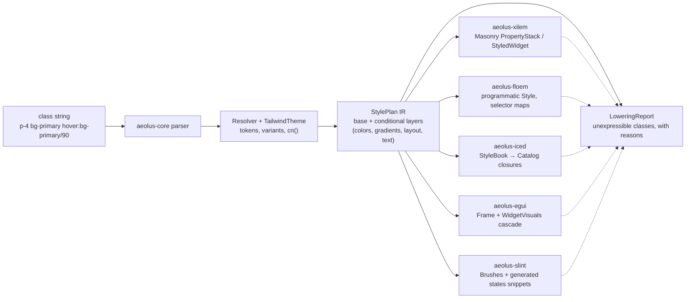

<div align="center">
  
  <p>
    <strong>Tailwind CSS v4 class styling, compiled to native properties for Xilem, Floem, Iced, egui and Slint</strong><br/>
    Aeolus parses Tailwind v4 class strings, resolves theme tokens and variants, and lowers
    the result into <code>StylePlan</code>, a typed IR that framework backends turn into
    Masonry property stacks, Floem styles, Iced style books, egui Frames or Slint brushes
    and <code>states</code> snippets. shadcn/ui's v4 class tables ship verbatim, so
    components keep their web vocabulary. Semantics are verified against the
    <code>tailwindcss</code> v4.1.17 source, and every class a backend cannot express is
    reported through <code>LoweringReport</code> — never dropped silently.
  </p>
  <p>
    <a href="https://github.com/elcoosp/aeolus/actions/workflows/ci.yml"></a>
    <a href="CHANGELOG.md"></a>
    <a href="LICENSE-MIT"></a>
    <a href=".github/workflows/ci.yml"></a>
    <a href=".github/workflows/ci.yml"></a>
  </p>
</div>

<p align="center">
  <a href="#quickstart">Quickstart</a> • <a href="#features">Features</a> • <a href="#how-it-works">How it works</a> • <a href="#usage">Usage</a> • <a href="#status">Status</a> • <a href="#learn-more">Learn more</a>
</p>

## Quickstart

Rust 1.96 or newer for the GUI path; `aeolus-core` alone builds on 1.88. Add the crates from git (backends are git-only for now — see [Status](#status)):

```toml
[dependencies]
aeolus-core = { git = "https://github.com/elcoosp/aeolus" }
aeolus-xilem = { git = "https://github.com/elcoosp/aeolus" }
```

Then style any Xilem view with a class string:

```rust
use aeolus_core::{Resolver, shadcn_default};
use aeolus_xilem::TwViewExt;
use xilem_masonry::view::label;

// Once at startup: the embedded shadcn light palette becomes the theme.
let theme = shadcn_default().unwrap();
let resolver = Resolver::new(&theme);

// In a view function: classes in, a styled widget out.
let save = label("Save changes").tw(
    &resolver,
    "p-4 bg-primary text-primary-foreground rounded-md hover:bg-primary/90",
);
```

No build step, no CSS file, no browser. The string is parsed, theme-resolved, and lowered into Masonry properties at runtime; `.tw` panics on unparseable classes in debug builds and warns plus drops styling in release — the honest-failure contract, not a silent no-op.

The same resolver drives the Iced, egui and Slint backends — `aeolus-iced` lowers into a `StyleBook` your Catalog closures resolve per `button::Status`/`&Theme`, `aeolus-egui` lowers into an `egui::Frame` plus the `WidgetVisuals` cascade that plain `egui::widgets::Button` picks up per frame, and `aeolus-slint` lowers into Slint's own value types plus the generated `.slint` property bindings and `states [ … ]` blocks its `TouchArea` machinery restyles from:

```rust,ignore
// egui: a real interactive shadcn button (hover/press restyle via the
// widget-visual cascade — egui's own state machinery).
aeolus_shadcn::egui::button(ui, &resolver, "Save changes",
    ButtonVariant::Default, ButtonSize::Default, "");

// iced: a style book for container(...).style(...) / button(...).style(...).
let book = aeolus_shadcn::iced::button_book(&resolver,
    ButtonVariant::Default, ButtonSize::Default, "");
button(Text::new("Save changes")).style(book.button_style_fn())

// slint: the generated code a TouchArea-driven Rectangle restyles itself
// from — hover/press/disabled/focus are `states` on the element's own
// properties, and every emitted binding is compiler-validated in CI.
let book = aeolus_shadcn::slint::button_book(&resolver,
    ButtonVariant::Default, ButtonSize::Default, "");
println!("{}", book.base_snippet());
println!("{}", book.to_states_snippet_focused("ta", "fs"));
```

## Features

- **Tailwind v4 semantics, checked at the source.** The parser, theme registry, and variant resolver are verified against the `tailwindcss` v4.1.17 source (`candidate.ts`, `compile.ts`, `variants.ts`), not the docs alone. Arbitrary selector variants (`[&:hover]`, `[a&]`, `[@media(print)]`) classify into typed probe conditions or fail with a per-form precise reason.
- **A typed IR, not CSS text.** `StylePlan` carries base plus conditional layers with typed slots (color, padding, borders, shadows, typography, transitions, gradients). Backends consume it directly; `diff()` with cosmetic/geometric lanes drives repaint-only restyling.
- **Gradient backgrounds, native on Masonry.** `bg-linear-*` / `bg-radial` / `bg-conic*` / `bg-none` compose at plan time into `ResolvedStyle.background_gradient` (a separate slot from the solid `background`, mirroring CSS's `background-color` + `background-image` coexistence). Masonry lowers them into its layout-invariant `Background::Gradient` with oklab interpolation; Floem reports with a sharpened geometry reason. Semantics pinned against the real tailwindcss 4.1.17 output (`tools/capture_gradients.mjs`).
- **shadcn/ui class tables, verbatim.** Eight components (Button, Input, Label, Card, Badge, Separator, Skeleton, Alert) copied from the shadcn `new-york-v4` registry; `button()` and `input()` are real interactive widgets on Xilem, the rest are style-only and say so.
- **`cn()` conflict resolution.** tw_merge-compatible: an audited conflict-group table drives classification (including the v0.6 split of `bg-color`/`bg-image` and per-edge gradient stops), approximate equality handles float ties, and the function is total and idempotent on any input — the user's class, merged last, wins.
- **Themes from CSS variables.** `@theme` / `:root` / `.dark` CSS with `calc()` at real operator precedence; the verbatim Tailwind v4 default theme and palette plus shadcn light/dark palettes are embedded via `include_str!`; theme swaps are explicit and version-tracked.
- **A verification emitter + parity harness.** `Resolver::to_css` reproduces v4's per-class declaration shapes (including the `--tw-gradient-*` var machinery); a golden corpus generated by the real `tailwindcss` v4.1.17 pins class → CSS equivalence end-to-end (176 entries). This is a verification and debugging tool — backends still consume `StylePlan` directly.
- **A hardened hot path.** Six fuzz targets (CI fuzzes four of them for 60s on every push to main), property tests, bounded caches, a counting global allocator that pins the hot-path allocation contract (`diff` of equal plans allocates ZERO — verified), and 306 tests plus doc tests (270 core/backends + 36 across the new Slint suites). A cold resolve of the 33-class shadcn Button string takes 4.6 µs; a warm cached hit is ~405 ns (divan, release profile, Linux CI sandbox — method and caveats in `reports/08-benchmarks/BENCHMARKS.md`).
- **Portable, composable plans (v0.7).** `StylePlan::overlay` composes two RESOLVED plans later-wins-per-slot (the IR-level mirror of `cn()`, diff-integrated so repaint-vs-relayout lanes survive composition), and `to_snapshot_json`/`from_snapshot_json` turn the IR into a canonical byte-stable JSON artifact with a STRICT reader (unknown fields are errors, never defaults). The new headless `aeolus-cli` consumes both: `resolve` (plan snapshots), `css` (verification CSS), `diff` (lane-aware), `cn`, and `check` — a class-string linter for source files with `--fail-on` exit codes for CI.

## How it works

`aeolus-core` is the semantic layer: class strings in, tokens resolved against a `TailwindTheme`, conflicts merged by `cn()`, and a `StylePlan` out. Backends lower the plan into their framework's native cascade and negotiate capabilities up front — whatever a backend cannot express lands in a `LoweringReport` with a reason, per the no-silent-failures rule.



| Crate           | Role                                                                                                                                                                                                                          | Publishes |
| --------------- | ----------------------------------------------------------------------------------------------------------------------------------------------------------------------------------------------------------------------------- | --------- |
| `aeolus-core`   | parser, theme registry, `StylePlan` IR, `cn()`, plan algebra (`overlay`), canonical plan snapshots, verification CSS emitter, bounded caches — zero dependencies                                                                                                              | ready     |
| `aeolus-macro`  | `tw!` / `tw_cn!` compile-time class validation and merging (syn-free)                                                                                                                                                         | ready     |
| `aeolus-cli`    | the headless surface: `resolve`/`css`/`diff`/`cn`/`check` — plan snapshots, verification CSS, lane-aware diffs, class-string linting (zero dependencies beyond the core)                                                      | git-only  |
| `aeolus-xilem`  | Masonry/Xilem backend: `PropertyStack` lowering, native gradients, fallback `StyledWidget`, interactive `StyledButton`                                                                                                        | git-only  |
| `aeolus-floem`  | Floem backend: nested selector maps, transitions, responsive and dark, the full pinned-rev taffy surface (overflow, grid, align-content, selectable, whitespace, border stroke dashes) — zero view-side code                  | git-only  |
| `aeolus-iced`   | Iced backend: `StyleBook` of base + state layers + dark, resolved per `button::Status` / `&Theme` by the Catalog closures; gradients native, constructor-argument hints for padding/sizes/typography, full-parity `IcedProbe` | git-only  |
| `aeolus-egui`   | egui backend: `Frame` fills/strokes/corner-radius/inner+outer margins/shadows, hover/active onto the `WidgetVisuals` cascade, cursor/wrap/selectability/spacing hints, full-parity `EguiProbe`                                | git-only  |
| `aeolus-slint`  | Slint backend: native gradient brushes, per-corner radii, drop+inner shadows with spread, element-property lowering plus compiler-validated generated `.slint` bindings and `states` blocks, full-parity `SlintProbe`         | git-only  |
| `aeolus-shadcn` | shadcn v4 class tables shared by every backend, plus Xilem/Floem/Iced/egui/Slint wrappers                                                                                                                                     | git-only  |

`crates/muda-stub` is a dev-sandbox patch crate wired through `[patch.crates-io]`; it is not a workspace member and is never a dependency of a publishable crate.

## Usage

### Resolve classes without a widget

```rust
let resolution = resolver.resolve("p-4 bg-primary hover:bg-primary/90 rounded-md")?;
assert!(resolution.plan.base.background.is_some());
assert_eq!(resolution.plan.layers.len(), 1); // the hover layer
assert!(resolution.warnings.is_empty());
```

`Resolver::resolve` returns the plan plus `Warning`s; unsupported classes come back as precise `Unsupported` reasons rather than blanket failures.

### Compose shadcn components

```rust
use aeolus_shadcn::xilem::button;
use aeolus_shadcn::classes::{ButtonSize, ButtonVariant};

button(
    &resolver,
    "save",
    "Save",
    ButtonVariant::Default,
    ButtonSize::Default,
    "shadow-lg", // your class merges last and wins via cn()
    |state: &mut AppState| state.save(),
)
```

On Floem, the same class tables lower into `Style` values with nested selector maps — hover and focus flips restyle one element without rebuilding widgets, and `transition-*` maps to native Floem transitions. On egui the `button` wrapper is equally interactive (the cascade is egui's own `WidgetVisuals` state machine), and on Iced `button_book` feeds the standard `Catalog` closures so `Hovered`/`Pressed`/`Disabled` statuses restyle without any rebuild.

### Swap or extend themes

```rust
let mut theme = TailwindTheme::from_theme_css(custom_brand_css)?;
theme.absorb_css(dark_mode_overrides)?; // bumps the theme version; drop the PlanCache
```

`shadcn_default()` and `shadcn_dark()` build the standard shadcn light and dark themes from the embedded palettes; any CSS you pass is resolved on top of the full Tailwind v4 default theme.

### Compose plans and take them portable (v0.7)

```rust
// Plan algebra: a component's cached plan + per-instance overrides,
// without a theme reference or a re-resolve. Later wins per slot.
let base = resolver.resolve(button_classes)?.plan;
let overrides = resolver.resolve("px-8 rounded-full uppercase")?.plan;
let merged = base.overlay(&overrides);
let d = aeolus_core::diff(&base.base, &merged.base); // exactly the override slots

// The IR is an artifact: canonical, byte-stable, strictly parseable JSON.
let json = merged.to_snapshot_json();
let same_plan = StylePlan::from_snapshot_json(&json)?; // == merged
```

The same surfaces work from the shell:

```sh
aeolus resolve "p-4 bg-primary hover:bg-primary/90" | jq .   # the plan snapshot artifact
aeolus diff "p-4" "p-8"                                      # lane-aware: repaint vs relayout
aeolus check src/ --fail-on unknown                          # lint class strings in CI
```

`check` extracts quoted class strings (a documented "looks like Tailwind" heuristic), reports unknown classes with suggestions, unsupported utilities with reasons, and `cn()` conflicts with the winning token attributed — exit 1 when `--fail-on` findings exist.

> [!TIP]
> For static class lists, `aeolus-macro`'s `tw!("p-4 bg-primary")` validates the string against the v4 grammar at compile time and `tw_cn!` merges at compile time — typos become build errors.

### Supported backends

| Backend         | Crate          | Lowering target                                                                               | Notes                                                                                                                                                                                                                                                                                                                                                                                              |
| --------------- | -------------- | --------------------------------------------------------------------------------------------- | -------------------------------------------------------------------------------------------------------------------------------------------------------------------------------------------------------------------------------------------------------------------------------------------------------------------------------------------------------------------------------------------------- |
| Xilem / Masonry | `aeolus-xilem` | `PropertyStack` + `Selector` flags; `StyledWidget` fallback resolves per state at pre-paint   | hover/active/focus/disabled native; **gradient backgrounds native** (`Background::Gradient` — linear exact, radial = documented circle-farthest-corner normalization, conic reported: upstream vello sweep TODO); dark, responsive, container, group/peer through the plan resolver                                                                                                                |
| Floem           | `aeolus-floem` | programmatic `Style` with nested selector maps                                                | transitions, responsive, dark mode native; ring lowers to outline; **the full pinned-rev taffy surface is now wired** — per-axis overflow, grid templates + placement, `align_content`, `selectable`, whitespace wrap, kurbo border-stroke dashes; gradients report with a sharpened geometry reason                                                                                               |
| Iced            | `aeolus-iced`  | `StyleBook` resolved per state by the Catalog closures (`container::Style` / `button::Style`) | hover/active/disabled via `button::Status` (no `Focused` status in Iced 0.14 — reported, probe path serves it); **linear gradients native** with CSS compass angles (radial/conic reported: upstream Gradient is linear-only); per-corner radius native; `opacity-*` bakes into every painted alpha; padding/sizes/spacing/typography as constructor-argument hints; margin/layout/position report |
| egui            | `aeolus-egui`  | `Frame` + the `WidgetVisuals` per-state cascade                                               | hover/active onto `widgets.{hovered,active}` (egui 0.37 has no disabled/focused visuals slot — reported, probe path serves it); CSS padding = `inner_margin`, **margin = `outer_margin` (native)**; per-corner radius native; shadows with spread native; gradients report (solid `Color32` fills); cursor/RichText typography/item-spacing/selectability/wrap hints                               |

Per-slot support for each backend is tabulated in `reports/02-capability-matrix/CAPABILITY_MATRIX.md`; the design rationale lives in `reports/03-aeolus-core-design/DESIGN.md`.

## Status

> [!NOTE]
> Aeolus is at **v0.7.0** (2026-11). The **portable-plans** release: the `StylePlan` IR becomes a first-class ARTIFACT — it composes (`StylePlan::overlay`, the plan-level mirror of `cn()`), it persists (`to_snapshot_json`/`from_snapshot_json`, a canonical byte-stable JSON format with a strict, path-qualified reader), and it is consumable headlessly (`aeolus-cli`: `resolve`/`css`/`diff`/`cn`/`check`, with `check` linting class strings inside source files and failing CI via `--fail-on`). No backend, parser, or MSRV changes; no new dependencies anywhere — `snapshot.rs` is a hand-rolled JSON writer/reader and `aeolus-cli` keeps the core's zero-dependency discipline. `aeolus-core` and `aeolus-macro` remain publish-ready (`cargo package` is a CI gate); the five backend crates and `aeolus-cli` carry `publish = false` — consume from git. Toolchains: Rust 1.88 gates `aeolus-core`/`aeolus-macro`/`aeolus-cli`, 1.96 gates the backends. Known deferred items (documented, test-pinned): per-edge layer semantics (`p-4 hover:px-8` layers carry zeroed unset edges — an IR-model fix deferred to v0.8), the taffy grid/placement families still reported by the resolver, and snapshot-based `PlanCache` persistence. The v0.6 upstream-ceiling reconnaissance (floem pin = latest `main` HEAD; xilem pin unchanged) remains current.

### What's in v0.7 — honestly

**Done and tested (core + CLI suites green; workspace battery unchanged):**

- **Plan algebra** (v0.7 §1): `StylePlan::overlay` — later-wins per slot; layers merge by condition and stay rank-ordered; responsive/dark/group/peer buckets overlay per key; rules merge by `Cond` equality; idempotent; diff-integrated (`diff(base, merged)` reports exactly the override's slots, so backends keep their repaint-vs-relayout lanes). Pinned by 8 tests in `tests/plan_algebra.rs`.
- **Canonical plan snapshots** (v0.7 §2): `to_snapshot_json` (fixed schema order, compact, shortest round-trip floats — byte-stable for equal plans) and `from_snapshot_json` (STRICT: unknown fields/enum names, duplicate keys, wrong header, truncation, trailing content → typed `SnapshotError` with a dotted path like `$.base.extras.grid.cols`). Hand-rolled depth-limited JSON parser; non-finite floats encode as strings so the writer is total; the closed keyword table keeps `TextValue::Keyword(&'static str)` sound. Pinned by 9 tests in `tests/snapshot_roundtrip.rs`, including a 256-string deterministic random round-trip.
- **`aeolus-cli`** (v0.7 §3): the headless surface — `resolve` (snapshot JSON by default, `--summary` for humans), `css`, `diff` (lanes + `--json`), `cn`, and `check` (the class-string linter: documented extractor heuristic, warning findings, `cn()` conflict attribution, `--fail-on` exit codes for CI). Zero dependencies beyond the core; the whole program is the library `run(args, out, err) -> code`. Pinned by 12 tests.
- **Benchmarks** (v0.7 §4.2): `plan_overlay_button`, `snapshot_write_button`, `snapshot_read_button`, `snapshot_roundtrip_button` in the core's `benches/hot.rs`; `benches/pipeline.rs` in the CLI crate (extraction, lint, snapshot read/write/round-trip).
- **Discovered and pinned, deferred honestly** (v0.7 §1.4): per-edge families in conditional layers materialize unset edges as 0 (a `hover:px-8` layer replaces the base's top/bottom padding with 0 on hover) — an IR-model fix (per-edge set-mask) deferred with a pinned test, not silently kept or silently changed.

<details><summary><b>What was in v0.6 — honestly</b></summary>

**Done and tested (306 tests):**

- Everything listed under v0.5 below.
- **Upstream reconnaissance, verifiable** (`AEOLUS_V0.6.md` §3): the floem pin `1351ffb` IS latest `main` HEAD (`git ls-remote`); xilem upstream moved `9f504ae → dc49687` — exactly 3 commits with an EMPTY `masonry_core`/`xilem_masonry` diff, so the pin stays. Every capability below is consumed at the pinned revs with ZERO upstream changes.
- **Gradient backgrounds** (v0.6 §1): the plan IR gains the composed `background-image` (`bg-linear-to-*`/`bg-linear-<angle>`/`bg-radial`/`bg-conic*`, the deprecated `bg-gradient-to-*` alias, `from-`/`via-`/`to-*` stops with `/opacity` modifiers and `%` position patches, `bg-none`) — semantics pinned against the REAL tailwindcss 4.1.17 output captured by `tools/capture_gradients.mjs` (stop-position defaults 0/50/100%, missing stops = `#0000`, oklab interpolation). Masonry lowers gradients NATIVELY into its layout-invariant `Background::Gradient` (`GradientShape::Linear` takes the CSS angle; `a = π − θ` derived from masonry's paint math and unit-pinned) — the capability matrix's "gradients dropped" row was stale. Floem keeps the honest report with a sharpened reason (peniko needs concrete geometry; `paint_bg` fills as-is). Single-brush reality: a solid + gradient coexistence keeps the gradient and records the flattening.
- **The Floem unwired surface** (v0.6 §2): `overflow-*` → taffy `overflow_x`/`overflow_y` (auto → Scroll documented); `select-none`/`select-text` → the inherited `Selectable` prop; `whitespace-normal` → `TextOverflow::Wrap` and `whitespace-nowrap` → floem's default (a documented no-op); `content-*` → `align_content` (normal → stretch, baseline reported); `grid-cols-N`/`grid-rows-N`/`col/row-span`/`col/row-start` → the native grid template + placement surface; `border-dashed`/`border-dotted`/`border-none` → kurbo `Stroke` dash patterns on the side strokes. The parity ledger upgrades six slots Reported → Native.

</details>

<details><summary><b>What was in v0.5 — honestly</b></summary>

**Done and tested (185 tests):**

- **Element-relative typography** (`AEOLUS_V0.5.md` §1, reverses the v0.4 §2.3 exclusion): the plan IR now carries the relative unit the class names — `TextValue::TrackingEm(f32)` for `tracking-*` tokens and `TextValue::LineHeightRatio(f32)` for bare `leading-*`. Absolute forms (px, spacing multiples, the paired line-height of a bare `text-{size}`) stay exactly as they were. Floem lowers `LineHeightRatio` to its NATIVE `LineHeightValue::Normal(ratio)` (font-size relative); `TrackingEm` keeps the honest drop report (no letter-spacing property at the pin). The golden corpus grows (176 entries total) and pins the relative units against the real compiler.
- **The allocation contract** (`AEOLUS_V0.5.md` §3): a counting global allocator (`std::alloc::GlobalAlloc` over `System`, zero dependencies) turns report 08's structural claims into measured numbers. `diff` of equal plans allocates ZERO (pinned exactly); the interning hit path and the warm cache hit are pinned as upper bounds. divan 0.1.21 cannot carry per-benchmark allocation counters (re-verified and documented); the contract test IS the deliverable the report asked for.
- Benchmarks re-run; the report-08 numbers updated with the honesty caveats unchanged.

What was in v0.4 (`AEOLUS_V0.4.md`, 157-entry corpus at that point):

- **The verification CSS emitter** — `Resolver::to_css(classes) -> Result<Vec<CssRule>, …>` reproduces v4's per-class declaration shapes. This is a VERIFICATION and debugging tool, not a styling target — backends consume `StylePlan` directly.
- **The golden corpus** (`tools/gen_golden.mjs` + `crates/aeolus-core/tests/fixtures/golden/`) generated by the real `tailwindcss` v4.1.17 — class → CSS equivalence pinned end-to-end.
- **The parity harness** with a test-only normalizer (var substitution, calc evaluation, rem→px, shadow composition, color-mix numeric comparison).
- `css_write_button` benchmark added; the allocation-counter follow-up deferred to v0.5.

</details>

## Learn more

- [`docs/release-notes/AEOLUS_V0.7.md`](AEOLUS_V0.7.md) — the v0.7 plan of record: plan algebra (`StylePlan::overlay`), canonical plan snapshots, and the `aeolus-cli` headless surface
- [`docs/release-notes/AEOLUS_V0.6.md`](AEOLUS_V0.6.md) — the v0.6 plan of record: the upstream ceiling, gradient backgrounds (native on Masonry), the wired Floem surface, and the 2026-11-07 upstream re-verification
- [`docs/release-notes/AEOLUS_V0.5.md`](AEOLUS_V0.5.md) — the v0.5 plan of record: element-relative typography, the allocation contract, and the divan re-test
- [`docs/release-notes/AEOLUS_V0.4.md`](AEOLUS_V0.4.md) — the v0.4 plan of record: the verification CSS emitter, the golden corpus, and the parity harness
- [`docs/release-notes/AEOLUS_V0.3.md`](AEOLUS_V0.3.md) — the v0.3 plan of record: arbitrary selector variants and the typed probe subset
- [`docs/release-notes/AEOLUS_V0.2.md`](AEOLUS_V0.2.md) — the v0.2 plan (shipped in 0.2.0): correctness fixes, the parity engine, MSRV split
- [`reports/03-aeolus-core-design/DESIGN.md`](reports/03-aeolus-core-design/DESIGN.md) — architecture, the `Probe` parity model, and the honesty contract (see §13 for the v0.7 portable plans)
- [`reports/02-capability-matrix/CAPABILITY_MATRIX.md`](reports/02-capability-matrix/CAPABILITY_MATRIX.md) — cascade models and per-slot support for every backend (gradient/overflow/grid rows updated for v0.6)
- [`reports/08-benchmarks/BENCHMARKS.md`](reports/08-benchmarks/BENCHMARKS.md) — hot-path numbers with the benchmark method and the allocation contract
- [`reports/10-tdd-evidence/09-portable-plans.md`](reports/10-tdd-evidence/09-portable-plans.md) — RED→GREEN evidence for v0.7
- [`reports/10-tdd-evidence/08-upstream-ceiling.md`](reports/10-tdd-evidence/08-upstream-ceiling.md) — RED→GREEN evidence for v0.6
- [`CONTRIBUTING.md`](CONTRIBUTING.md) — TDD-first workflow and the no-silent-failures bar
- [`docs/`](docs/) — brand assets
