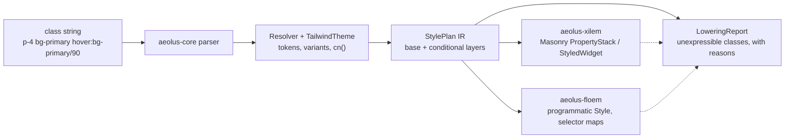

<div align="center">
  
  <p>
    <strong>Tailwind CSS v4 class styling, compiled to native properties for Xilem and Floem</strong><br/>
    Aeolus parses Tailwind v4 class strings, resolves theme tokens and variants, and lowers
    the result into <code>StylePlan</code>, a typed IR that framework backends turn into
    Masonry property stacks or Floem styles. shadcn/ui's v4 class tables ship verbatim, so
    components keep their web vocabulary. Semantics are verified against the
    <code>tailwindcss</code> v4.1.17 source, and every class a backend cannot express is
    reported through <code>LoweringReport</code> — never dropped silently.
  </p>
  <p>
    <a href="https://github.com/elcoosp/aeolus/actions/workflows/ci.yml"></a>
    <a href="CHANGELOG.md"></a>
    <a href="LICENSE-MIT"></a>
    <a href=".github/workflows/ci.yml"></a>
    <a href=".github/workflows/ci.yml"></a>
  </p>
</div>

<p align="center">
  <a href="#quickstart">Quickstart</a> • <a href="#features">Features</a> • <a href="#how-it-works">How it works</a> • <a href="#usage">Usage</a> • <a href="#status">Status</a> • <a href="#learn-more">Learn more</a>
</p>

## Quickstart

Rust 1.96 or newer for the GUI path; `aeolus-core` alone builds on 1.88. Add the crates from git (backends are git-only for now — see [Status](#status)):

```toml
[dependencies]
aeolus-core = { git = "https://github.com/elcoosp/aeolus" }
aeolus-xilem = { git = "https://github.com/elcoosp/aeolus" }
```

Then style any Xilem view with a class string:

```rust
use aeolus_core::{Resolver, shadcn_default};
use aeolus_xilem::TwViewExt;
use xilem_masonry::view::label;

// Once at startup: the embedded shadcn light palette becomes the theme.
let theme = shadcn_default().unwrap();
let resolver = Resolver::new(&theme);

// In a view function: classes in, a styled widget out.
let save = label("Save changes").tw(
    &resolver,
    "p-4 bg-primary text-primary-foreground rounded-md hover:bg-primary/90",
);
```

No build step, no CSS file, no browser. The string is parsed, theme-resolved, and lowered into Masonry properties at runtime; `.tw` panics on unparseable classes in debug builds and warns plus drops styling in release — the honest-failure contract, not a silent no-op.

## Features

- **Tailwind v4 semantics, checked at the source.** The parser, theme registry, and variant resolver are verified against the `tailwindcss` v4.1.17 source (`candidate.ts`, `compile.ts`, `variants.ts`), not the docs alone. Arbitrary selector variants (`[&:hover]`, `[a&]`, `[@media(print)]`) classify into typed probe conditions or fail with a per-form precise reason.
- **A typed IR, not CSS text.** `StylePlan` carries base plus conditional layers with typed slots (color, padding, borders, shadows, typography, transitions). Backends consume it directly; `diff()` with cosmetic/geometric lanes drives repaint-only restyling.
- **shadcn/ui class tables, verbatim.** Eight components (Button, Input, Label, Card, Badge, Separator, Skeleton, Alert) copied from the shadcn `new-york-v4` registry; `button()` and `input()` are real interactive widgets on Xilem, the rest are style-only and say so.
- **`cn()` conflict resolution.** tw_merge-compatible: an audited conflict-group table drives classification, approximate equality handles float ties, and the function is total and idempotent on any input — the user's class, merged last, wins.
- **Themes from CSS variables.** `@theme` / `:root` / `.dark` CSS with `calc()` at real operator precedence; the verbatim Tailwind v4 default theme and palette plus shadcn light/dark palettes are embedded via `include_str!`; theme swaps are explicit and version-tracked.
- **A hardened hot path.** Six fuzz targets (CI fuzzes four of them for 60s on every push to main), property tests, bounded caches, and 165 tests plus doc tests. A cold resolve of the 33-class shadcn Button string takes 4.6 µs; a warm cached hit is ~405 ns (divan, release profile, Linux CI sandbox — method and caveats in `reports/08-benchmarks/BENCHMARKS.md`).

## How it works

`aeolus-core` is the semantic layer: class strings in, tokens resolved against a `TailwindTheme`, conflicts merged by `cn()`, and a `StylePlan` out. Backends lower the plan into their framework's native cascade and negotiate capabilities up front — whatever a backend cannot express lands in a `LoweringReport` with a reason, per the no-silent-failures rule.



| Crate | Role | Publishes |
|---|---|---|
| `aeolus-core` | parser, theme registry, `StylePlan` IR, `cn()`, bounded caches — zero dependencies | ready |
| `aeolus-macro` | `tw!` / `tw_cn!` compile-time class validation and merging (syn-free) | ready |
| `aeolus-xilem` | Masonry/Xilem backend: `PropertyStack` lowering, fallback `StyledWidget`, interactive `StyledButton` | git-only |
| `aeolus-floem` | Floem backend: nested selector maps, transitions, responsive and dark — zero view-side code | git-only |
| `aeolus-shadcn` | shadcn v4 class tables shared by every backend, plus Xilem/Floem wrappers | git-only |

`crates/muda-stub` is a dev-sandbox patch crate wired through `[patch.crates-io]`; it is not a workspace member and is never a dependency of a publishable crate.

## Usage

### Resolve classes without a widget

```rust
let resolution = resolver.resolve("p-4 bg-primary hover:bg-primary/90 rounded-md")?;
assert!(resolution.plan.base.background.is_some());
assert_eq!(resolution.plan.layers.len(), 1); // the hover layer
assert!(resolution.warnings.is_empty());
```

`Resolver::resolve` returns the plan plus `Warning`s; unsupported classes come back as precise `Unsupported` reasons rather than blanket failures.

### Compose shadcn components

```rust
use aeolus_shadcn::xilem::button;
use aeolus_shadcn::classes::{ButtonSize, ButtonVariant};

button(
    &resolver,
    "save",
    "Save",
    ButtonVariant::Default,
    ButtonSize::Default,
    "shadow-lg", // your class merges last and wins via cn()
    |state: &mut AppState| state.save(),
)
```

On Floem, the same class tables lower into `Style` values with nested selector maps — hover and focus flips restyle one element without rebuilding widgets, and `transition-*` maps to native Floem transitions.

### Swap or extend themes

```rust
let mut theme = TailwindTheme::from_theme_css(custom_brand_css)?;
theme.absorb_css(dark_mode_overrides)?; // bumps the theme version; drop the PlanCache
```

`shadcn_default()` and `shadcn_dark()` build the standard shadcn light and dark themes from the embedded palettes; any CSS you pass is resolved on top of the full Tailwind v4 default theme.

> [!TIP]
> For static class lists, `aeolus-macro`'s `tw!("p-4 bg-primary")` validates the string against the v4 grammar at compile time and `tw_cn!` merges at compile time — typos become build errors.

### Supported backends

| Backend | Crate | Lowering target | Notes |
|---|---|---|---|
| Xilem / Masonry | `aeolus-xilem` | `PropertyStack` + `Selector` flags; `StyledWidget` fallback resolves per state at pre-paint | hover/active/focus/disabled native; dark, responsive, container, group/peer through the plan resolver |
| Floem | `aeolus-floem` | programmatic `Style` with nested selector maps | transitions, responsive, dark mode native; ring lowers to outline |

Per-slot support for each backend is tabulated in `reports/02-capability-matrix/CAPABILITY_MATRIX.md`; the design rationale lives in `reports/03-aeolus-core-design/DESIGN.md`.

## Status

> [!NOTE]
> Aeolus is at **v0.3.0** (2026-11). The core language is complete against the v0.3 plan of record: every Tailwind v4 variant form either resolves to typed probe conditions or fails with a per-form precise reason. `aeolus-core` and `aeolus-macro` are publish-ready (`cargo package` is a CI gate), while the three backend crates carry `publish = false` until upstream Masonry/Xilem and Floem cut crates.io releases of the pinned revisions — consume all crates from git for now. Toolchains: Rust 1.88 gates `aeolus-core`/`aeolus-macro`, 1.96 gates the backends, both enforced in CI; Linux, macOS, and Windows run the full suite. Known upstream-blocked gaps: view-side property-stack registration, native Masonry typography, and Masonry transitions — each is documented, and everything a backend cannot express is reported, never ignored.

## Learn more

- [`AEOLUS_V0.3.md`](AEOLUS_V0.3.md) — the v0.3 plan of record: arbitrary selector variants, semantics, and what stays upstream-blocked
- [`reports/03-aeolus-core-design/DESIGN.md`](reports/03-aeolus-core-design/DESIGN.md) — architecture, the `Probe` parity model, and the honesty contract
- [`reports/02-capability-matrix/CAPABILITY_MATRIX.md`](reports/02-capability-matrix/CAPABILITY_MATRIX.md) — cascade models and per-slot support for every backend
- [`reports/08-benchmarks/BENCHMARKS.md`](reports/08-benchmarks/BENCHMARKS.md) — hot-path numbers with the benchmark method and caveats
- [`AEOLUS_V0.2.md`](AEOLUS_V0.2.md) — the v0.2 plan (shipped in 0.2.0): correctness fixes, the parity engine, MSRV split
- [`CONTRIBUTING.md`](CONTRIBUTING.md) — TDD-first workflow and the no-silent-failures bar
- [`docs/`](docs/) — brand assets
